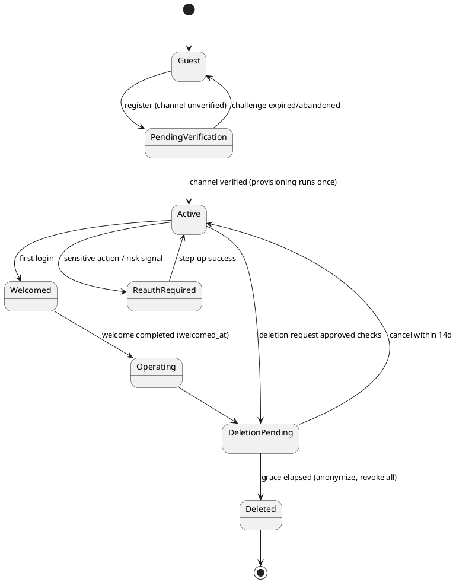
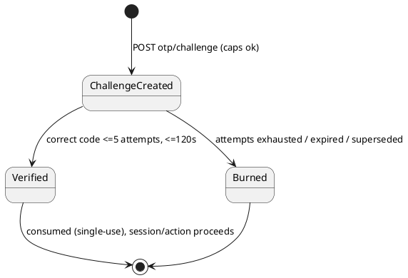

# SPEC-AUTH-EXT-01 — Registration, Authentication, Account Recovery, Profile Security, and Onboarding

**Status: SPECIFICATION ONLY — implementation is NOT authorized by this document.**
Baseline: Laravel 13 / React 19 / Tailwind CSS 4, modular monolith, Persian RTL, Ocean design system (`/theme-previews` canonical; primary `#39677C`, background `#F5F9FA`, white content surfaces with subtle borders and **no box shadows** per UX-DS-DEC-01 / ADR-0020). Existing three shells and UX-02-1 environment navigation are preserved. Nothing in this spec authorizes code changes; ambiguities are surfaced with a recommended default (§15) for explicit approval.

---

## 1. Current-code audit (verified against the repository)

### 1.1 Already implemented (reuse; do not rebuild)

| Capability | Where | Notes |
|---|---|---|
| Email/username + password login | `AuthController::login`, `POST /api/v1/auth/login` (throttle 20/min) | Web-session guard + `session()->regenerate()`; per-login throttling, blocked-account messages |
| API token login | `POST /api/v1/auth/token` (Sanctum) | For non-browser clients |
| Registration | `AuthController::register`, `RegisterRequest` (throttle 5/min) | Creates `users` row (name, unique username, optional `phone`, optional title), role from `config('auth.registration.*')`, status `active|pending`, optional auto-login. **Does not** provision a personal workspace, does not require terms acceptance, no email verification gate |
| Password recovery **via Bale** | `baleCode` / `baleResetPassword` + `AuthModal` `forgot` mode | Code (6 digits) only to a previously linked Bale account; no email reset-link flow, no SMS |
| Bale login | `baleCode`/`baleLogin`, `balePanelLogin` | OTP-in-Bale channel exists and must keep working |
| Verified-email identity | migration `2026_10_15_000014` (`users.email`, `users.email_verified_at`, `core_email_verification_challenges` DATETIME expiry) + `app/Core/Identity/EmailVerificationService.php` | Challenge hash storage + delivery abstraction (mail) already exists |
| Profile + basic security UI | `features/identity/UserProfileView.tsx` («امنیت حساب», change password), `app/shell/ProfileDock.tsx` | Change-password exists; no sessions/devices UI, no email/mobile change, no deletion request |
| Account lifecycle | `app/Core/Identity/AccountLifecycle.php`, `LastActiveAdminGuard` | Status transitions exist (active/blocked/pending); deletion-request workflow NOT present |
| Invitations | UX-02-3 `InvitationManagerPage`, Core invitations tables (Stage C-stage work) | Acceptance is explicit already on the org side; post-registration invitation review surface specified here (§5.17) |
| Personal workspaces & subscriptions | UX-02-1 environments; `CoreSubscription.personal_workspace_id`, `SubscriptionOwner('personal')`, C5 subscription services | Personal owner type exists; **no provisioning on signup, no Personal Free entitlement issuance** |
| Audit/activity | `ActivityLog`, Core audit (ADR-0016) | Login success recorded; security-event taxonomy to extend (§7) |

### 1.2 Missing (this package specifies)

1. SMS OTP login/registration (Iranian mobile, `+98` normalization) — no SMS provider integration exists.
2. Google OIDC (PKCE) sign-in and identity linking — absent.
3. Email reset-link password recovery (A01) — absent (Bale-only today).
4. Terms acceptance capture (versioned evidence) — absent.
5. Idempotent personal-workspace + Personal Free provisioning on activation — absent.
6. One-time welcome page (workspace / create organization / review invitations) — absent (selector is the post-login landing today).
7. Verified email change (A02), OTP mobile change (A03) — absent (fields editable without verification).
8. Session/device management UI + revoke-others (A04) — absent.
9. Risk-based reauthentication challenge (A05) — absent.
10. OTP rate limits/cooldown/enumeration-resistance contract (A06) — partial via route throttles only.
11. Controlled account-deletion request (A07) — absent.
12. Password change with reauthentication + optional invalidate-others (A08) — change exists; reauth/invalidation absent.
13. Mobile-only account recovery path (no verified email) — unspecified today.

---

## 2. Identity model (normative)

- `users` remains the account root. Login identifiers: `username` (unique, existing), verified `email` (unique when non-null — see §6.1), verified mobile (`phone` normalized E.164 `+98…`, unique when verified — §6.2).
- An account may carry several **auth identities**: password, Bale link (existing), Google subject (new `user_external_identities`). Identity linking never merges two existing accounts automatically (§4.5).
- `users.email_verified_at` and new `users.phone_verified_at` are the only trusted contact facts. Unverified contact edits (current behavior) are withdrawn by this package: contact changes go through §4.6/§4.7 flows only.
- Account status (`AccountStatus`) unchanged; `pending` registrations cannot authenticate until activated (verification completed), per §8 state machine.

---

## 3. Approved decisions A01–A08 (normative restatement)

| ID | Decision |
|---|---|
| A01 | Password recovery for verified-email accounts uses **one-time, expiring links** (single-use token, hashed at rest, invalidated on use/expiry/password change). |
| A02 | Email change requires verifying the **new** address; the **previous** address receives a security notification; the old address stays authoritative until the new one verifies. |
| A03 | Mobile change requires OTP verification of the new number + security notification to the old channel(s). |
| A04 | Users can list active sessions/devices and **sign out other sessions**. |
| A05 | Suspicious/sensitive activity triggers **risk-based reauthentication** (password or OTP step-up) before proceeding. |
| A06 | OTP flows enforce rate limits, attempt limits, cooldowns, expiry and **enumeration resistance** (uniform responses). |
| A07 | Account deletion is a **controlled request** with resource-ownership and legal-retention checks; never an instant hard delete. |
| A08 | Password change requires **reauthentication** (current password) and offers **invalidate other sessions**. |

Non-goals: no new SMS/Google credentials are invented here (operator-provided via server config, §13); no subscription purchase inside registration; notification read-state is never legal acknowledgment (UX-02-4 / SYS-MSG-01 boundary).

---

## 4. Functional contracts

### 4.1 Sign-in — email/username + password
Existing endpoint retained. Response never reveals whether the identifier or the password was wrong (`invalid_credentials`). 5 consecutive failures per identifier+IP locks the identifier for 10 minutes (in addition to existing route throttle); lockouts are audited.

### 4.2 Sign-in/registration — mobile SMS OTP
- Input normalized: strip spaces/dashes, accept `09…`, `9…`, `+989…`; store/compare E.164 `+98…`. Invalid format → field error, no challenge created.
- `POST /auth/otp/challenge {phone, purpose: login|register|mobile_change}` creates a challenge **only after** caps pass (§7). Response is uniform (`{sent: true, expires_in_seconds: 120}`) whether or not the number maps to an account (enumeration resistance, A06); for `login` purpose on unknown numbers the response is identical but no SMS is dispatched (audit-logged internally).
- Code: 6 digits, `Hash::make`-hashed in `auth_otp_challenges`, TTL 120s, max 5 verify attempts, then challenge burned. Resend cooldown 60s, max 5 challenges/hour/number, 20/day/IP.
- Verify success consumes the challenge (single-use), then: login → session issued; register → continue §4.4 with mobile verified.

### 4.3 Google OIDC
- `GET /auth/google/redirect` builds the authorization URL with PKCE (`code_challenge_method=S256`), `state` + `nonce` stored server-side in the session (10-min TTL, single-use). Scopes: `openid email profile` only.
- `GET /auth/google/callback` validates state, exchanges code, verifies `id_token` (signature via Google JWKS, `iss`, `aud`, `exp`, `nonce`). Failures land on the return/error screen (§5.5) with a Persian, non-technical message; no account is created or linked on partial failure.
- Identity resolution order: (1) `user_external_identities(provider=google, subject)` → sign in; (2) verified Google email matching an existing **verified** user email → offer linking only after password reauthentication (A05), never silent auto-link; (3) otherwise → registration continuation with email/name prefilled, email treated as verified (Google-asserted), terms acceptance still required.

### 4.4 Registration (minimum profile)
- Required: display name; one verified channel (email+password, mobile OTP, or Google); password when email channel chosen (≥10 chars, `PasswordByteLimit` rule reused); **explicit terms checkbox** with document version (§6.6). Mobile is optional for email/Google registration.
- Username: if not chosen by the user, generated from the verified identifier (existing unique `username` column stays the internal handle).
- Duplicate verified identifier → uniform "an account with this contact exists; sign in or recover" guidance; no data about the existing account is exposed.
- On activation (channel verified): §4.5 provisioning runs **once**, then welcome state is set (§4.8).

### 4.5 Personal workspace + Personal Free provisioning (idempotent)
- New `users.personal_workspace_provisioned_at` (nullable DATETIME) + unique index on the workspace owner relation (§6.7). Provisioning service `PersonalWorkspaceProvisioner`:
  1. In one transaction: create personal workspace (kind `personal`, owner = user) if none exists for the user; attach **Personal Free** plan version (C5 catalog dependency §13) via `SubscriptionService`; set `personal_workspace_provisioned_at`.
  2. Safe to run repeatedly/concurrently (unique constraint + `firstOrCreate` semantics); a partially completed registration leaves `personal_workspace_provisioned_at = null` and provisioning is retried on next login (self-healing), never duplicating the workspace.
- No payment instrument, no checkout, no trial clock that converts silently.

### 4.6 Email change (A02)
`Settings → امنیت حساب`: enter new email → challenge via existing `EmailVerificationService` (purpose `email_change`) → verify link/code → transaction swaps `users.email`, sets `email_verified_at`, writes security event, and **emails the previous address** ("your sign-in email was changed; if this wasn't you…") + in-app security notification (UX-02-4, category `system`, never mutable). Pending change expires in 30 min; requesting a second change invalidates the first.

### 4.7 Mobile change (A03)
Same pattern with SMS OTP on the new number; on success the **old** number (if verified) and verified email receive a security notification. Mobile-only accounts (no verified email) recover via: OTP to the currently verified mobile; if the mobile is lost, the documented manual path is administrator-assisted identity proofing (audit-logged, §4.10) — the spec does **not** invent a weaker self-service bypass.

### 4.8 Welcome (one-time)
New `users.welcomed_at`. After first activation, login lands on `/welcome` (exactly once; completion sets `welcomed_at`): three cards — «ورود به فضای کاری شخصی» (default landing thereafter), «ایجاد سازمان» (existing org-creation route), «بررسی دعوت‌نامه‌ها» (pending invitations list with explicit accept/decline; accepting uses existing invitation acceptance transitions; **never auto-join**). Skippable; afterwards the UX-02-1 selector remains the landing per its existing rules.

### 4.9 Sessions & devices (A04)
Sessions are Sanctum personal-access tokens (API clients) + web sessions for the SPA. New read model over `sessions` (web) + `personal_access_tokens` with `user_agent`/IP/last-used: list, "current" marker, revoke one, **revoke all others** (keeps the current credential, rotates the session ID). Revocations are audited; revoked web sessions die on next request.

### 4.10 Deletion request (A07)
`POST /account/deletion-request {password}` (reauthenticated): checks — owns organizations/workspaces with other members (must transfer or dissolve first), is final Primary admin (blocked, existing `LastActiveAdminGuard`), pending legal retention (SYS-MSG/financial records retained per policy list in §6.8). Result: account enters `deletion_pending` with 14-day grace (login shows countdown + cancel option; sign-in allowed only to cancel), then lifecycle job anonymizes personal fields and revokes all identities/sessions; records under legal retention are kept detached from the identity. Every transition audited.

### 4.11 Reauthentication (A05/A08)
Sensitive actions (password/email/mobile change, identity linking, deletion request, revoke-others) require `reauthenticated_at` within 10 minutes, else the challenge screen (§5.15): password re-entry or OTP to a verified channel. Risk signals (new device/IP change after long dormancy) force step-up at login: credentials accepted → challenge → session issued.

---

## 5. Screen inventory (real Ocean routes; public screens outside app shells)

All authenticated screens live under the existing ProfileDock/account navigation; public screens are standalone Ocean pages (no platform sidebar). Every screen: PageSurface (no shadow, ADR-0020), RTL, focus-visible canonical outline, loading skeleton, inline Persian validation, error banner with retry, success → stated destination.

| # | Screen | Route | Key fields / states | Success → |
|---|---|---|---|---|
| 1 | Login + method selection | `/login` | username/email + password; «ورود با شماره موبایل»; «ورود با Google»; method tabs; wrong-credentials, locked, blocked, step-up-required states | welcome (first time) else selector |
| 2 | Registration | `/register` | name*, channel tabs (email/mobile/Google), password (email path), terms checkbox* with version link; duplicate-contact guidance | verify screen per channel |
| 3 | Email verification | `/verify/email` (+ link landing `/verify/email/confirm?token=`) | code/link pending, expired (resend), already-verified, wrong-account states | provisioning → `/welcome` |
| 4 | Mobile OTP | `/verify/mobile` | 6-digit code, countdown, resend (cooldown), attempts-left, expired | provisioning → `/welcome` |
| 5 | Google return/error | `/auth/google/complete` | processing, link-required (password reauth), provider error (cancelled/unavailable), success | `/welcome` or selector |
| 6 | Forgot password | `/forgot-password` | verified email input; **uniform sent response**; mobile-only guidance (Bale/OTP per §4.7) | check-inbox state |
| 7 | Set new password | `/reset-password/{token}` | new password + confirm; expired/used token states; strength meter | `/login` with success notice; other sessions invalidated + security notification |
| 8 | Welcome | `/welcome` | 3 cards (personal workspace / create org / invitations w/ pending count) | chosen destination |
| 9 | Account profile | `/account/profile` | display name, title, avatar; read-only verified contacts with change actions | stays, saved toast |
| 10 | Account security | `/account/security` | links/cards to 11–16, active sessions summary, security events list | — |
| 11 | Change email | `/account/security/email` | new email, pending state, verified/failed outcomes | security page |
| 12 | Change mobile | `/account/security/mobile` | new mobile, OTP verify inline | security page |
| 13 | Change password | `/account/security/password` | current* (reauth), new, confirm, «ابطال نشست‌های دیگر» checkbox (default on) | security page |
| 14 | Sessions & devices | `/account/security/sessions` | device list, current marker, revoke / revoke-others, empty state | stays |
| 15 | Reauth challenge | `/account/security/reauthenticate` (modal-capable route) | password or OTP method, attempts, cancel returns safely | back to originating action |
| 16 | Deletion request | `/account/security/delete` | ownership-check results, blocked reasons, grace explanation, password confirm, confirm/cancel in grace | signed out + confirmation page |
| 17 | Invitations review | `/account/invitations` (also welcome card target) | pending invitations, explicit accept/decline, expired states | org/workspace per acceptance |

Validation messages (Persian, normative examples): «رمز عبور یا نام کاربری نادرست است.» · «کد تأیید منقضی شده است؛ کد تازه درخواست کنید.» · «تلاش‌های مجاز تمام شد؛ چند دقیقه دیگر دوباره تلاش کنید.» · «این شماره موبایل معتبر نیست.» · «پذیرش قوانین و مقررات الزامی است.» — all strings live in the existing lang/validation layer, not hard-coded in components.

---

## 6. Database contracts (MariaDB 10.4-safe; additive; DATETIME not TIMESTAMP per repo convention)

### 6.1 `users` alterations
| Column | Type | Notes |
|---|---|---|
| `phone_verified_at` | DATETIME NULL | set only by OTP verify |
| `personal_workspace_provisioned_at` | DATETIME NULL | §4.5 marker |
| `welcomed_at` | DATETIME NULL | §4.8 |
| `reauthenticated_at` | DATETIME NULL | step-up freshness |
| `deletion_requested_at` | DATETIME NULL | A07 grace clock |
Unique indexes: `users_email_unique` (existing email unique kept; NULLs exempt), `users_phone_verified_unique` on `phone` — implement as generated-column unique only if backfill proves no duplicates; otherwise application-level check + follow-up cleanup migration (contractor must verify with `SELECT phone, COUNT(*) … HAVING COUNT(*)>1` preflight and report, not guess).

### 6.2 `auth_otp_challenges` (new)
`id`, `user_id` NULL FK→users SET NULL, `phone` VARCHAR(16) (E.164), `purpose` VARCHAR(24) (`login|register|mobile_change|reauth`), `code_hash` VARCHAR(255), `attempts` TINYINT default 0, `expires_at` DATETIME, `consumed_at` DATETIME NULL, `request_ip` VARCHAR(45), `created_at`. Indexes: `(phone, purpose, created_at)`, `(expires_at)`. Retention: rows deleted after 24h by scheduled prune. Codes never stored plaintext; no Bale reuse (Bale challenges stay in their existing table).

### 6.3 `user_external_identities` (new)
`id`, `user_id` FK→users CASCADE, `provider` VARCHAR(16) (`google`), `subject` VARCHAR(191), `email_at_link` VARCHAR(320) NULL, `created_at`, `last_login_at` NULL. Unique `(provider, subject)`; index `(user_id)`. Linking rules §4.3; unlink forbidden when it would leave the account with no sign-in method.

### 6.4 Password recovery tokens
Reuse framework `password_reset_tokens` (hashed, `created_at`): enforce single-use by delete-on-success, 60-min expiry, delete-all-on-password-change. No new table.

### 6.5 Terms evidence — `user_terms_acceptances` (new)
`id`, `user_id` FK CASCADE, `document_key` VARCHAR(40) (`terms|privacy`), `document_version` VARCHAR(20), `accepted_at` DATETIME, `ip` VARCHAR(45). Index `(user_id, document_key)`. Current versions are config (`auth.terms.current_version`); re-acceptance prompt when version bumps (non-blocking banner except where legally required — future SYS-MSG-01 hook).

### 6.6 Sessions
Use existing `sessions` + `personal_access_tokens`; add `personal_access_tokens.device_label` VARCHAR(120) NULL backfilled from `name`. No schema change to `sessions`.

### 6.7 Provisioning idempotency
Unique index on workspaces' owner for personal kind — if the environments schema lacks a discriminating column, add `workspaces.owner_user_id` BIGINT NULL + `kind` check at application level and unique `(owner_user_id)` where `kind='personal'` (MariaDB 10.4: plain index + transactional `firstOrCreate`; contractor verifies existing personal-workspace representation from the UX-02-1 schema and reports the exact column in the implementation plan — this is a specified verification step, not an invention license).

### 6.8 Security events
Extend `ActivityLog` types (no new table): `auth.login`, `auth.login_failed`, `auth.lockout`, `auth.otp_challenged`, `auth.otp_verified`, `auth.password_changed`, `auth.password_reset`, `auth.email_changed`, `auth.mobile_changed`, `auth.identity_linked`, `auth.sessions_revoked`, `auth.deletion_requested`, `auth.deletion_cancelled`, `auth.deletion_completed`. Legal-retention list for A07 is configuration (`auth.deletion.retention_models`), initially: subscriptions/invoices, audit logs, SYS-MSG records (future).

### 6.9 Rollback/backfill
All migrations additive; `down()` drops only new tables/columns. Backfill: none required except `device_label` (nullable). Safe on MariaDB 10.4.32 `tadbir`; never `migrate:fresh`.

---

## 7. API contracts (prefix `/api/v1`, session+CSRF for web, Sanctum where existing)

| Endpoint | Purpose | Key rules |
|---|---|---|
| `POST auth/login` | existing | + step-up challenge response `code: reauth_required` |
| `POST auth/otp/challenge` | §4.2 | uniform response; throttles §4.2; audit |
| `POST auth/otp/verify` | login/register/reauth verify | single-use; session issued on login |
| `GET auth/google/redirect`, `GET auth/google/callback` | §4.3 | PKCE, state/nonce, error → §5.5 |
| `POST auth/google/link` | link after reauth | A05 |
| `POST auth/register` | existing, extended | terms fields required; channel verification state enforced; provisioning on activation |
| `POST auth/password/forgot` | A01 | uniform response; link via mail delivery abstraction |
| `POST auth/password/reset` | A01 | token single-use; invalidates other sessions; security notification |
| `GET/POST account/security/email/change` | A02 | pending-change model §4.6 |
| `POST account/security/mobile/change` (+otp verify) | A03 | notifications to old channels |
| `POST account/security/password` | A08 | current password + `invalidate_others` flag |
| `GET account/sessions`, `DELETE account/sessions/{id}`, `POST account/sessions/revoke-others` | A04 | current credential protected |
| `POST account/reauthenticate` | A05 | password or OTP; sets `reauthenticated_at` |
| `POST account/deletion-request`, `POST account/deletion-request/cancel` | A07 | ownership checks §4.10 |
| `GET account/welcome`, `POST account/welcome/complete` | §4.8 | invitations via existing invitation endpoints |
Thresholds live in `config/auth.php` (single place, env-overridable, no secrets in code). SMS sender behind `SmsOtpDelivery` interface (mirror of `EmailVerificationDelivery`); **the provider (e.g., an Iranian gateway) is selected by operator config — credentials are deployment secrets, never specified here**. On provider outage: challenges return `delivery_unavailable` with retry guidance, Bale/email channels remain available; no silent fallback that weakens verification.

---

## 8. State machines (PlantUML)

---

## 9. Implementation milestones (ordered; each independently reviewable)

1. **M1 Identity groundwork**: migrations §6.1–6.3, 6.5–6.6, phone normalization helper + tests; existing login/register untouched behaviorally.
2. **M2 OTP**: `auth_otp_challenges`, `SmsOtpDelivery` abstraction + log/test driver, challenge/verify endpoints, A06 limits, OTP screens (§5.4) + login method tab (§5.1).
3. **M3 Email recovery + terms**: A01 forgot/reset (uniform responses), terms capture at registration, screens §5.6–5.7.
4. **M4 Google OIDC**: redirect/callback/link, identity table usage, §5.5; behind `services.google` config; disabled state hides the button.
5. **M5 Provisioning + welcome**: §4.5/§4.8, Personal Free via C5 (dependency D1), §5.8/§5.17.
6. **M6 Account security**: email/mobile change, password A08, sessions A04, reauth A05, screens §5.9–§5.15.
7. **M7 Deletion (A07)** + anonymization job + retention config, §5.16.
8. **M8 Hardening**: enumeration/abuse test pass (§10), throttles review, audit taxonomy complete, Laragon smoke (§11).

## 10. Acceptance & security-abuse tests

- OTP: expired code, 6th attempt burns, resend cooldown, hourly cap, unknown-number login response byte-identical to known-number, code reuse rejected, challenge superseded by newer one.
- Recovery: token reuse rejected, token dies on password change, forgot response identical for known/unknown emails.
- Google: state mismatch, nonce mismatch, reused code, link attempt without reauth (blocked), link to existing verified email requires §4.3 step 2.
- Sessions: revoke-others kills a second browser session, current survives; password change with invalidate-others.
- Provisioning: double activation (concurrent) yields exactly one personal workspace + one Personal Free subscription.
- Deletion: final-Primary blocked; org-with-members blocked with reasons; cancel inside grace restores full access; after grace, login impossible, retained records detached.
- Enumeration: register duplicate verified email leaks nothing beyond generic guidance.
- Authorization: all `/account/**` endpoints reject other users' ids (self-only), guest → 401.
- UX gates: every §5 screen renders at 1440/834/390 RTL, no shadow on PageSurface (UX-DS-DEC-01 gate), focus order sane, Persian validation visible.

## 11. Laragon smoke plan (Windows)

1. Backup `tadbir` DB; `php artisan migrate:status` preflight (expect only additive files pending).
2. `php artisan migrate` + `php artisan tadbir:seed-essential`.
3. Configure `.env`: mail (log driver ok), SMS test driver (log), Google keys **only if testing M4** (leave empty otherwise — button hidden).
4. Register via email → verify → welcome appears once → personal workspace in selector; register again with same email → generic duplicate guidance.
5. Mobile OTP with test driver: read code from log, login succeeds; 6 wrong attempts burn the code.
6. Forgot password → reset via logged link → other browser session signed out.
7. Security pages: change email (old address notified in log), sessions list shows both browsers, revoke others works.
8. Deletion request on a throwaway account with no org ties → grace banner; cancel restores.

## 12. Traceability (decision → surface → backend → status)

| Decision | Screens | Backend | Status |
|---|---|---|---|
| A01 email reset links | §5.6–5.7 | §6.4, forgot/reset endpoints | Specified, missing in code |
| A02 email change | §5.11 | §4.6, challenges reuse | Specified, missing |
| A03 mobile change | §5.12 | §4.7 OTP | Specified, missing |
| A04 sessions/devices | §5.14 | §6.6 endpoints | Specified, missing |
| A05 reauth | §5.15 (+login step-up) | `reauthenticated_at` | Specified, missing |
| A06 OTP limits | §5.4 states | §4.2 caps, uniform responses | Specified, partial (route throttles only) |
| A07 deletion request | §5.16 | §4.10, §6.8 | Specified, missing |
| A08 password change | §5.13 | reauth + invalidate flag | Partially implemented (change exists) |
| Terms evidence | §5.2 | §6.5 | Specified, missing |
| Personal Free provisioning | §5.8 | §4.5, §6.7 | Specified, missing |
| Invitations explicit accept | §5.17 | existing invitation transitions | Implemented (org side); review surface specified |
| Google OIDC | §5.1/5.5 | §4.3, §6.3 | Specified, missing |
| Mobile-only recovery | §5.6 guidance | §4.7 manual path | Specified |

## 13. Dependencies & genuine blockers

- **D1 (C5-EXT-01 policy)**: a versioned **Personal Free** plan must exist in the C5 catalog before M5 can attach it; provisioning code takes the plan key from config (`auth.personal_free_plan_key`) — if C5-EXT-01 has not landed, M5 ships disabled behind a flag. **Blocker for M5 only.**
- **D2 (operator)**: SMS gateway choice + credentials (deployment secret). Spec ships interface + log driver; production driver is an ops decision. **Blocks production OTP, not implementation.**
- **D3 (operator)**: Google OAuth client registration (operator-owned). Button hidden until configured.
- **D4**: SYS-MSG-01 mandatory notices may later reuse terms/notice evidence — integration boundary only; not a blocker.
- Existing accounts: no forced migration; unverified legacy emails keep working for login, but email change/recovery require verification going forward (grandfathered, audit-logged).

## 14. Security invariants (acceptance-blocking)

Password/token/code hashing at rest everywhere; no OTP or reset token in URLs except single-use reset links (referrer-safe, `Referrer-Policy: no-referrer` on §5.7); session regeneration on every privilege change; CSRF on all web mutations; all auth endpoints throttled; audit events §6.8; no `indigo` legacy UI on new screens; no secrets in repo or spec.

## 15. Ambiguities surfaced (recommended defaults — approval required)

1. **Username**: keep as internal unique handle (auto-generated) — *default: yes*, avoids breaking existing references.
2. **Personal Free limits**: owned by C5-EXT-01 — *default: reference plan key only*.
3. **SMS provider**: *default: interface + log driver in this package; gateway selection is an operator decision before production.*
4. **Step-up at login risk signals**: *default: new-device-after-30-days-dormancy only in v1.*
5. **Deletion grace**: *default: 14 days* (product/legal confirmation requested).
6. **Phone uniqueness preflight** (§6.1): if duplicates exist in legacy data, *default: application-level enforcement first, cleanup migration second*.

**End of specification. Implementation requires separate explicit authorization.**
