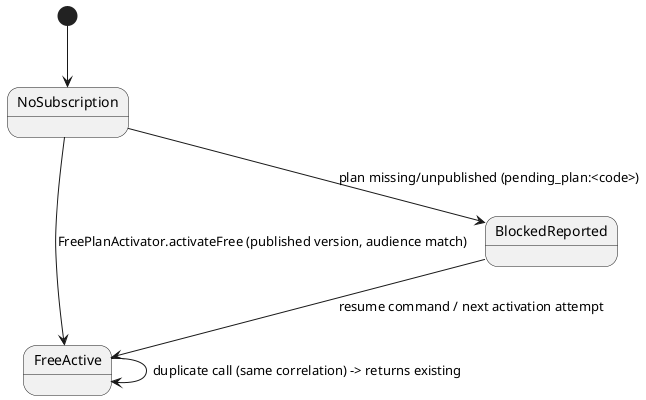

# SPEC-C5-EXT-01 — Plans, Subscriptions, Entitlements, Checkout, Payments, Renewals & Billing

**Status:** SPECIFICATION ONLY — implementation **NOT authorized**. Prepared 2026-10-19 under the C5-EXT-01 specification authorization. Builds exclusively on the implemented C5‑1…C5‑4 core (plan catalog, subscriptions, entitlement evaluation, platform administration) and the AUTH-EXT-01 provisioning contract. No parallel billing/subscription/entitlement engine may be introduced.

Governing product rules (authorization, binding): separate personal vs organizational subscription ownership; Personal Free = 1 personal workspace / 1 member / 3 active projects / 100 MB; Organization Free = 1 active organizational workspace / 3 members / 5 active projects / 100 MB; free-plan identities stable and versioned; existing customers never silently reassigned. Billing rules B01–B07 / FIN01–FIN04 as restated normatively in §3 (the repository records their substance in the C5‑1…C5‑4 stage reports; the B/FIN labels are the authorization's index for the same decisions — traceability in §12).

---

## 1. Current-code audit (verified against the repository)

### 1.1 Already implemented and verified (reuse; do not rebuild)

| Capability | Where | Evidence |
|---|---|---|
| Versioned plan catalog | `core_plans` (unique `key`, `audience`, `status`), `core_plan_versions` (`version`, `grace_days`, `published_at`; unique plan+version; immutable once published), `core_plan_module_entitlements`, `core_plan_limits` (composite PKs, RESTRICT FKs) | Migration `2026_10_15_000010`; `App\Core\Plans\PlanProvisioner` (draft/publish/snapshot/`latestPublished`, drift rejected); `PlanSchemaMysqlTest` |
| Resource-limit vocabulary | `PlanResourceCatalog`: `workspaces`, `organization_members`, `workspace_members`, `storage_bytes` (unknown keys rejected; stored `0` = hard zero; `is_unlimited` flag) | `App\Core\Plans\PlanResourceCatalog` |
| Subscriptions | `core_subscriptions` (organization XOR personal-workspace owner enforced by generated `owner_key` UNIQUE + CHECK), `core_subscriptions.status_version` optimistic locking | Migration `2026_10_15_000011` |
| Subscription periods (immutable history) | `core_subscription_periods` (`operation` ∈ initial/renewal/plan_change; unique `(subscription_id, correlation_id)`) | Migrations `000011`, `000012` |
| Subscription service | `SubscriptionService::assignInitial / renew / changePlan / snapshotForWorkspace / history` — transactional, correlation-idempotent, audited; **every entry point requires the `platform.subscriptions.manage` platform permission** | `App\Core\Subscriptions\SubscriptionService` |
| Plan-change preview | `PlanChangePlanner::preview` — non-mutating impact + confirmation token; limit comparison against measured usage | `App\Core\Subscriptions\PlanChangePlanner` |
| Lifecycle states | `SubscriptionLifecycle::evaluate` (Missing/NotStarted/Active/Grace/Expired/Invalid — pure function of stored UTC boundaries) | `App\Core\Subscriptions\{SubscriptionLifecycle,SubscriptionState}` |
| Entitlement evaluation | `SubscriptionEntitlementEvaluator` + `ModuleAccessGuard`: Active+entitled → Full; Grace → read-only; Expired with previously valid history → read-only; otherwise Denied (fail-closed); `module_read_only` denial code | C5‑3 report; `SubscriptionEntitlementEvaluatorTest`, `ProjectsSubscriptionAccessTest` |
| Usage measurement | `CoreResourceUsageReader::measure` — workspaces + member counts per owner; **`storage_bytes` measured as `null` (unknown)** | `App\Core\Subscriptions\CoreResourceUsageReader` |
| Platform administration API | 8 routes under `/api/v1/platform` (view/assign/renew/plan-change-preview/plan-change/history), platform-permission-only incl. reads; stable error contract (`subscription_exists`, `subscription_stale_version`, `usage_unknown`, …) | C5‑4 report; `PlatformSubscriptionController` |
| Usage display (org) | Dashboard summary exposes plan key/version, lifecycle state, limits **and measured usage** per limit | `DashboardSummaryController` |
| AUTH provisioning contract | `AccountActivationService`: pending→active, idempotent personal workspace, attach attempt with correlation `auth-activation-{userId}`, explicit `pending_plan:<code>` dependency recorded in audit; config `auth.personal_free_plan_key` (env `AUTH_PERSONAL_FREE_PLAN_KEY`), `auth.personal_free_plan_version` | AUTH-EXT-01 (ADR-0021 AMB-02=A) |
| Reminder/scheduler pattern | Idempotent reminder service + `Schedule::command(...)->everyMinute()->withoutOverlapping()` in `routes/console.php`; C7 notification inbox with muting rules (ordinary categories mutable; mandatory/security exempt) | `OverdueNotifications`, UX-02-4 |
| Concurrency proof | MySQL suites: `PlanSchemaMysqlTest`, `SubscriptionConcurrencyMysqlTest`, `EntitlementConcurrencyMysqlTest`, `PlanChangeConcurrencyMysqlTest`, `SubscriptionSchemaEngineTest` (CI) | `.github/workflows/quality.yml` |

### 1.2 Present but incomplete

1. **Free-plan attach is structurally blocked today.** `SubscriptionService::authorize()` requires a human platform actor; `AccountActivationService` passes the end user, so `assignInitial` always throws `subscription_forbidden` → every activation records `pending_plan:subscription_forbidden` even if a plan were configured. A narrow **system-actor** path inside the C5 domain is required (§4.1); AUTH code must not gain billing rules.
2. **Pending users never resume.** `AccountActivationService` only attempts attach while `personal_workspace_provisioned_at IS NULL`, then stamps it unconditionally. Users already stamped with `pending_plan` need a resume keyed on *subscription missing*, not on the timestamp (§4.2).
3. **`projects` is not a catalog resource.** Free-plan project caps (3 personal / 5 org) cannot be expressed or measured until `PlanResourceCatalog` gains `projects` and `CoreResourceUsageReader` measures active projects per owner.
4. **Storage usage is unknown.** `measure()` returns `storage_bytes: null`; the C5‑4 contract fails closed with `usage_unknown` in plan-change comparison. Storage-limit *enforcement* requires a real measure (§6.6).
5. **No runtime quota enforcement at write points.** Module entitlement + expired-read-only are enforced; creating a project/member/upload beyond plan limits is **not** yet blocked anywhere. Plan-change preview compares limits, but no create-path guard exists.
6. **Renewal is platform-admin only.** `SubscriptionService::renew` shares the platform authorization; no self-service renewal, no scheduled downgrade, no cancellation state (plan change is admin-driven with explicit `effectiveAt`; there is no proration math anywhere).
7. **Legacy owners have no subscription.** Pre-C5 organizations/workspaces show `plan: null` in dashboard summary; entitlement evaluator treats Missing per its table. Any defaulting must be explicit claim/assignment — never silent (§4.3).

### 1.3 Missing and required (this package specifies)

- Published **Personal Free / Organization Free** plan definitions + operational provisioning (§4).
- Plan **prices** (period/currency), published-price selectability (§6.2).
- Checkout **quotes** with validity window, **orders + line items**, **promo codes** with reservation/redemption, **tax rules** itemization, upgrade **credit** computation (daily proration) (§6–§7).
- **Payment gateway contract** (provider-neutral, config-gated like `SmsOtpDelivery`), payment attempts, server-side verification, callback replay safety, reconciliation (§7.3).
- **Receipts/invoices + PDF** generation and authorized download (§6.7).
- **Refunds/adjustments** with auditable state machine (§7.6).
- Self-service **billing UI** (personal + organization contexts) and public **pricing page** (§5).
- **Renewal/expiry reminders** (7/3/1 days) + grace handling jobs (§7.5).
- Runtime **quota enforcement** at project/member/storage create points with above-limit read-preservation (§7.4).

### 1.4 Blocked by external configuration (never faked)

- **Payment provider**: none configured in `config/services.php`; no gateway credentials exist. The contract ships with `UnavailablePaymentGateway` (fail-safe localized `payment_unavailable`) + `FakePaymentGateway` (tests only) until an operator configures a real provider (AMB-C5-02).
- **Prices**: no price data exists; nothing may be invented. Catalog screens render "price not published" states until operations publish prices.
- **PDF engine**: no PDF library in `composer.json` today (AMB-C5-05).

### 1.5 Explicitly outside this package

Auto-renewal charging (stored payment methods), card data handling of any kind, multi-currency storefronts beyond the configured currency set, dunning beyond the 7/3/1 reminders + grace, tax filing/reporting, marketplace/affiliate payouts, C5-EXT-01 checkout for add-ons/seats beyond plan purchase/renewal/upgrade/downgrade.

---

## 2. Ownership and context model (normative)

1. A subscription has exactly one owner: an **organization** or a **personal workspace** (existing XOR + `owner_key` UNIQUE — unchanged).
2. Personal billing context = the caller's own personal workspace. Organizational billing context = an organization in which the caller holds the billing authority (§8.2); organization selection for purchase is explicit and authorized — never inferred from ambient UI state alone.
3. Selected plan + context must survive the authentication round-trip (login/OTP/Google) via the existing safe `from` redirect state plus a server-side quote bound to owner + actor; a quote created pre-authentication is anonymous-inert and only becomes payable after the owner/authority checks pass at order creation (§7.2).
4. Cross-owner data exposure is forbidden: every billing read is owner-scoped and authority-checked; invoice/receipt downloads re-check authority at download time.

---

## 3. Approved billing decisions (normative restatement)

- **B01** Mid-cycle upgrades activate **after verified payment** only.
- **B02** Upgrade credit for the unused term is **daily-prorated**, transparently itemized (§7.4 formula).
- **B03** Downgrades take effect at the **end of the current billing term** (scheduled, §7.4); they never delete data.
- **B04** Above-limit after downgrade: data stays readable; only the relevant new writes/creates are restricted.
- **B05** Payment processing is **idempotent** end-to-end (quote → order → attempt → callback).
- **B06** Refunds/adjustments are first-class auditable records with state machines.
- **B07** Default grace = **7 days**, configurable by authorized administrators (realized as `grace_days` on each published plan version; platform provisioning sets 7 unless an authorized admin publishes otherwise — the C5‑1 storage default of 0 is a catalog default, not policy).
- **FIN01** Taxes itemized from valid configured tax rules only; no invented rates.
- **FIN02** Discounts bounded, non-stackable unless the promo definition explicitly permits stacking.
- **FIN03** All money is integer minor units (§6.1); no float arithmetic anywhere in billing.
- **FIN04** A configured quote stays valid for its approved validity window; afterwards it expires and must be re-quoted (prices are re-read; never silently extended).

---

## 4. Free-plan foundation (smallest safe unblock; independently shippable)

### 4.1 Publication of the Free plans (operations, versioned, immutable)

New console command **`plans:provision-free`** (platform-ops runbook; idempotent via existing `PlanProvisioner` semantics — republication is a no-op):

| Plan key | Audience | Version | grace_days | Limits (published v1) | Module entitlements |
|---|---|---|---|---|---|
| `personal-free` | personal | 1 | 7 | `workspaces`=1, `workspace_members`=1, `projects`=3, `storage_bytes`=104857600 | baseline module set (same modules the entitlement evaluator gates today) |
| `organization-free` | organization | 1 | 7 | `workspaces`=1, `organization_members`=3, `workspace_members`=3, `projects`=5, `storage_bytes`=104857600 | baseline module set |

- Requires the `projects` resource (§6.6 prerequisite code change) **before** publication, because `PlanProvisioner::setLimit` rejects unknown keys.
- Free plans carry **no price rows**; "price not published" must not block free activation (free activation never touches checkout).
- Keys are stable identities; any future limit change = **new published version**, never an edit (C5‑1 immutability). Existing subscribers stay on their version (no silent reassignment).

### 4.2 System-actor free activation inside C5 (no business rules in AUTH)

New C5 service **`FreePlanActivator`** (working name; `App\Core\Subscriptions`) with a single operation `activateFree(owner, actorContext, correlationId)`:

- Validates: owner is a personal workspace **or** organization; plan key from server-side config (`auth.personal_free_plan_key` for personal; `billing.organization_free_plan_key` for organizations); version published; audience matches owner type.
- Executes through the same transactional core as `assignInitial` (owner row lock → existing-subscription check → period `initial` + audit). Implementation route: add an internal `SubscriptionService::assignInitialWithContext(..., ActorContext $context)` where `ActorContext ∈ {PlatformHuman, SystemFreeActivation, OwnerSelfService}`; the existing public methods keep requiring `PlatformHuman`. The system path additionally requires the correlation prefix (`auth-activation-`, `free-claim-`) and is callable only from AUTH activation, the resume command, and the org claim endpoint — enforced by construction (no HTTP route exposes it generically).
- AUTH change is a **one-line delegation swap** in `AccountActivationService` (call `FreePlanActivator` instead of `SubscriptionService::assignInitial`) plus the resume-gate fix below. All plan knowledge stays in C5.

### 4.3 Resuming existing `pending_plan` accounts (safe, idempotent)

- Fix in AUTH: attempt attach whenever **no subscription exists for the personal workspace** (ask C5 via `SubscriptionOwnerResolver::subscriptionForPersonalWorkspace`), regardless of `personal_workspace_provisioned_at`; the correlation `auth-activation-{userId}` makes retries return the existing subscription (`assignInitial` idempotent-retry semantics).
- New console command **`subscriptions:resume-pending-free`**: scans users with a personal workspace and no subscription (chunked, `--dry-run` supported), activates via `FreePlanActivator`, and reports counts. Conflicts (a subscription exists on a *different* plan) are reported, never overwritten. Legacy accounts/workspaces keep all data; nothing is renamed or merged.
- Organizations: legacy organizations are **not** auto-assigned (AMB-C5-03 recommendation A: explicit claim). Organization Free is claimed by an authorized org billing actor from the billing overview ("فعال‌سازی اشتراک رایگان سازمان") → same activator with correlation `free-claim-org-{organizationId}`; duplicate claims return the existing subscription.

### 4.4 Why this can ship before paid checkout

Free activation touches only: catalog resource addition, one C5 service + context refactor, one-line AUTH delegation, two console commands, config values. No money tables, no gateway, no UI beyond the org claim button and the existing dashboard plan display. It unblocks every new registration immediately and is separately testable (§10, scenarios F1–F6).

---

## 5. UI/UX specification (Persian RTL, Ocean, ADR-0020 flat surfaces as amended by Amendment B)

Shell rules: authenticated billing lives **inside the main shell** with the right-hand RTL contextual sidebar (billing section nav), reached from ProfileDock («اشتراک و صورتحساب») and from the environment context; public pricing is a **standalone public page** (never inside authenticated sidebars). Standard surfaces: white, subtle border, **flat** — PageSurface, page wrappers, nested panels, tables, form sections and inline notices have **no shadow**; a standalone card may use ADR-0020 Amendment B's explicit `--shadow-surface: 0 1px 3px rgb(15 23 42 / 0.035)` opt-in only when recorded in the approved standalone-card inventory, and every unclassified card remains flat; floating layers (dialogs/drawers/menus) keep their functional elevation; environment-selection cards remain flat until separately approved. Amendment B is presentation-only: it changes no C5 API, entitlement/usage calculation, permission, subscription/plan state, pending-activation state, or dashboard-summary payload. Primary `#39677C`, hover `#2B5266`, background `#F5F9FA`.

| # | Screen (inventory ref) | Route | Type | Context / permission |
|---|---|---|---|---|
| 1 | Personal subscription overview | `/billing` (personal context) | page | own personal workspace |
| 2 | Organization subscription overview | `/billing` (organization context via context switcher) | same page, org context | org billing authority (§8.2) |
| 3 | Plan catalog & comparison | `/billing/plans` | page | context owner/authority |
| 4 | Plan selection + billing period | `/billing/plans` (period toggle; only configured+published monthly/annual prices selectable) | page section | — |
| 5 | Authorized organization selector | `/billing/plans` context header + `/billing` context switcher (only organizations where caller has billing authority; explicit choice persisted to the quote) | component | — |
| 6 | Order review (itemized) | `/billing/checkout/:quoteId` | page | quote owner + authority re-checked |
| 7 | Promo code application | inline section on `/billing/checkout/:quoteId` | component | — |
| 8 | Payment initiation + pending | `/billing/orders/:orderId` (pay action → provider redirect; bounded polling status block) | page section | — |
| 9 | Payment success / failure | `/billing/orders/:orderId` state views (verified server-side status; redirect params never trusted) | page states | — |
| 10 | Retry payment | action on `/billing/orders/:orderId` (new attempt on the same eligible order) | action | — |
| 11 | Renewal & upgrade/downgrade management | `/billing` actions → plan-change preview dialog (reuses C5‑4 preview contract: impact, limits, confirmation) | dialogs | authority |
| 12 | Scheduled downgrade / cancellation confirmation | confirmation dialog from `/billing` (effective date = term end, Persian date; data-preservation notice) | dialog | authority |
| 13 | Billing history & invoices | `/billing/orders` | page | owner-scoped list |
| 14 | Receipt details + PDF | `/billing/orders/:orderId` receipt section + `GET /api/v1/billing/orders/{order}/receipt.pdf` | page + download | authority re-checked |
| 15 | Resource usage & plan limits | `/billing` usage section (per-resource usage/limit bars; unknown usage shown as «نامشخص», never 0) | page section | — |
| 16 | Above-limit / grace warnings | persistent banner on `/billing` + contextual inline warnings at blocked create actions (API-driven) | banner | — |

Per-screen contract essentials (full detail in the implementation package; the UX/UI Agent reviews this table — §13):

- **Loading**: skeleton sections, no layout shift; **Empty**: no subscription → free-claim CTA (personal: informational, since activation is automatic; org: claim button); **Error**: localized fail-safe (`payment_unavailable`, `usage_unknown`, quote-expired with re-quote action); **Expired quote**: read-only summary + «دریافت پیش‌فاکتور تازه»; **Pending payment**: bounded polling (3s × 20, then manual refresh state; never infinite); **Failed payment**: reason-safe message + retry action; **Success**: only after server verification returns `paid`.
- Validation is Persian, inline, and server-authoritative for money: the client never computes totals it submits — it renders server quote/order snapshots.
- Accessibility: full keyboard path (focus-visible rings in Ocean primary), dialogs trap focus and return focus, status changes announced via `role=status`, polling never moves focus.
- Responsive: 1440 (two-column: summary + actions), 834 (stacked, sticky action bar), 390 (single column; tables become definition lists; itemization remains fully visible — financial data is never truncated away).
- Public pricing `/pricing`: standalone public route; lists published plans with **published prices only**; missing price → «تماس با فروش» state, never an invented number; preserves plan+context through auth (§2.3) via `from` state.

**Designer-review flags** (do not silently invent): exact comparison-table column policy on mobile; whether success/failure warrant separate URLs for support links (current spec: one order route, state views); banner persistence/dismissal rules for grace warnings; Toman vs Rial *display* convention (AMB-C5-01).

---

## 6. Database contracts (MariaDB 10.4-safe, additive; `dateTime` not bare `TIMESTAMP`; explicit defaults)

### 6.1 Money representation (normative)

All monetary values are **`BIGINT` minor units** + `currency CHAR(3)` (ISO 4217) on every money-bearing row. Arithmetic is integer-only; percentage rates are **basis points `INT`** (1 bp = 0.01%). Rounding: half-up at the final line computation, documented per formula (§7.4). No `FLOAT/DOUBLE/DECIMAL` money columns. (Currency-unit question — IRR minor unit semantics — is AMB-C5-01; the schema is unit-agnostic.)

### 6.2 Prices — `core_plan_prices` (new)

| Column | Type | Notes |
|---|---|---|
| `id` | BIGINT UNSIGNED PK | |
| `plan_version_id` | BIGINT UNSIGNED FK → `core_plan_versions` RESTRICT | price belongs to an immutable published version |
| `period` | VARCHAR(10) | `monthly` \| `annual` (CHECK on MySQL/MariaDB) |
| `currency` | CHAR(3) | |
| `amount_minor` | BIGINT | ≥ 0 (CHECK); free plans have **no rows** |
| `is_published` | TINYINT(1) default 0 | only published prices are selectable |
| `created_by_user_id` / timestamps | FK users nullOnDelete / `dateTime` | price rows immutable once referenced by any order line (§7.2); corrections = new row + unpublish old |

Unique: `(plan_version_id, period, currency, is_published)` cannot enforce single-published — enforced transactionally in the pricing service + partial guard via unique `(plan_version_id, period, currency, amount_minor)`; selectable price resolution = the single `is_published=1` row, absence ⇒ not selectable.

### 6.3 Tax rules — `billing_tax_rules` (new)

`id`, `key VARCHAR(60) UNIQUE`, `name VARCHAR(150)`, `rate_basis_points INT` (0–10000 CHECK), `is_active TINYINT(1)`, `valid_from/valid_to dateTime nullable`, `created_by_user_id`, timestamps. Orders snapshot the applied rule (key + rate) on the line — later rule edits never rewrite history.

### 6.4 Quotes & orders (new)

`billing_quotes`: `id`; owner pair `organization_id` NULL / `personal_workspace_id` NULL (same XOR + generated `owner_key` pattern as `core_subscriptions`); `plan_version_id` FK RESTRICT; `price_id` FK RESTRICT nullable (free); `period VARCHAR(10)`; `currency CHAR(3)`; `subtotal_minor`, `upgrade_credit_minor`, `discount_minor`, `tax_minor`, `total_minor` BIGINT; `promo_code_id` nullable FK; `status` (`open/converted/expired`) ; `expires_at dateTime`; `idempotency_key VARCHAR(80) UNIQUE`; `created_by_user_id`; timestamps. Unique active-quote guard enforced transactionally (new quote supersedes prior `open` quote for same owner+target).

`billing_orders`: `id`; `quote_id` FK **UNIQUE**; owner pair + `owner_key`; `status` (`pending_payment/paid/payment_failed/expired/cancelled/refund_pending/refunded/partially_refunded`); totals snapshot columns copied from quote at conversion (immutable thereafter); `idempotency_key VARCHAR(80) UNIQUE`; `paid_at dateTime nullable`; timestamps.

`billing_order_lines`: `id`; `order_id` FK RESTRICT; `kind` (`plan/upgrade_credit/discount/tax`); `description VARCHAR(300)`; `amount_minor BIGINT` (signed; credits/discount negative); `plan_version_id` nullable FK; `price_id` nullable FK; `tax_rule_key VARCHAR(60)` nullable + `tax_rate_basis_points` nullable INT (snapshots); `created_at`. Lines are insert-only (no updates/deletes — application-enforced + no update path in services).

### 6.5 Promo codes (new)

`billing_promo_codes`: `id`; `code_normalized VARCHAR(60) UNIQUE` (upper/trimmed; the raw code is a lookup key, not a secret — store normalized plaintext for support lookup, never log full codes in audit details); `kind` (`percent/fixed`); `value INT` (bp for percent, minor units for fixed); `currency CHAR(3)` nullable (fixed only); `max_redemptions INT nullable`; `redeemed_count INT default 0`; `per_owner_limit INT default 1`; `stackable TINYINT(1) default 0`; `starts_at/ends_at`; `is_active`; timestamps.
`billing_promo_reservations`: `id`; `order_id` FK; `promo_code_id` FK; `state` (`reserved/redeemed/released`); `idempotency_key UNIQUE`; timestamps; unique `(order_id, promo_code_id)`. Redemption increments `redeemed_count` inside the order-paid transaction with row lock (concurrent redemption safe).

### 6.6 Entitlement prerequisites (code, not schema)

- `PlanResourceCatalog` += `'projects' => 'Active projects per subscription owner'`.
- `CoreResourceUsageReader::measure` += `projects` (count of non-archived projects across owner workspaces; personal: its workspace) and a **real `storage_bytes`** measure from the existing file/asset store (sum of stored byte sizes per owner scope). Until the storage measure ships, storage stays `null` ⇒ enforcement for storage remains fail-closed-unknown (plan-change preview only), and create-path storage blocking must not be enabled against an unknown measure.

### 6.7 Payments, receipts, refunds (new)

`billing_payment_attempts`: `id`; `order_id` FK RESTRICT; `attempt_no INT`; `provider VARCHAR(40)`; `amount_minor BIGINT`; `currency CHAR(3)`; `status` (`initiated/pending/verified/failed/expired/reconciled_late`); `provider_reference VARCHAR(120)` nullable — unique `(provider, provider_reference)`; `callback_payload_hash CHAR(64)` nullable (SHA-256 of raw callback; raw payload never stored with card data — card data is never received at all); `verified_at dateTime nullable`; `idempotency_key UNIQUE`; timestamps.
`billing_receipts`: `id`; `order_id` FK **UNIQUE**; `receipt_number VARCHAR(40) UNIQUE` (sequential per currency+year allocated transactionally); snapshot totals columns; `pdf_path VARCHAR(300)` nullable; `issued_at`; timestamps.
`billing_refunds`: `id`; `order_id` FK RESTRICT; `amount_minor BIGINT`; `reason VARCHAR(500)`; `status` (`requested/approved/rejected/processed/failed`); `provider_reference` nullable; `idempotency_key UNIQUE`; actor columns; timestamps. Refund processing never mutates order lines; order status derives from refund sums.
`billing_reminder_log`: `id`; `subscription_id` FK; `kind` (`expiry_7d/expiry_3d/expiry_1d/expired/grace_ending`); `for_expires_at dateTime`; `sent_at`; unique `(subscription_id, kind, for_expires_at)`.
`core_subscription_scheduled_changes` (new, beside C5 core): `id`; `subscription_id` FK; `kind` (`downgrade/cancel`); `target_plan_version_id` nullable FK; `effective_at dateTime` (= current term `expires_at`); `status` (`pending/applied/cancelled/superseded`); `correlation_id VARCHAR(80)`; unique `(subscription_id, correlation_id)`; partial-active guard enforced transactionally (one pending change per subscription).

**Retention**: financial rows (orders, lines, attempts, receipts, refunds) are retained indefinitely (legal/financial record); quotes may be pruned after 180 days in `expired` state (console prune, dry-run first); reminder logs 1 year. All migrations additive; down() drops only tables created in the same migration; no changes to C5‑1/C5‑2 tables except the scheduled-changes addition. No destructive operation on Laragon `tadbir` data; provisioning commands are dry-run-capable and idempotent.

---

## 7. Algorithms and state machines (PlantUML + executable pseudocode)

### 7.1 Free activation (Amb-02 path)



```
activateFree(owner, correlation):
  tx:
    lock owner row; existing = subscriptionFor(owner)
    if existing: 
       if periodByCorrelation(existing, correlation): return existing
       throw conflict_reported            # never overwrite another plan
    version = latestPublishedOrPinned(freeKey(owner.type), audience must match)
    if !version: record pending_plan; return Pending
    create subscription(period=initial, starts=now, expires=+100y for free, grace=+version.grace_days)
    audit(subscription.assigned, actor=system, correlation)
```

### 7.2 Quote → order → payment

```plantuml
@startuml
state Quote { [*] --> Open; Open --> Expired: expires_at passed; Open --> Converted: create order }
state Order {
  [*] --> PendingPayment
  PendingPayment --> Paid: provider verify OK (server-side)
  PendingPayment --> PaymentFailed: verify failed / attempt expired
  PaymentFailed --> PendingPayment: retry (new attempt, same order)
  PendingPayment --> Expired: quote/order window closed w/o payment
  Paid --> RefundPending: refund approved
  RefundPending --> Refunded: refund processed (full)
  RefundPending --> PartiallyRefunded: refund processed (partial)
}
@enduml
```

Rules: totals are computed **server-side only** from the published price snapshot + credit + promo + tax; any client-submitted amount is ignored. Order creation requires an `open`, unexpired quote + authority re-check; conversion copies totals immutably. Payment initiation creates an **attempt** (monotonic `attempt_no`); the browser is redirected to the provider; **return/callback never marks paid** — the callback handler calls provider `verify(provider_reference)` server-side, and only a verified result transitions to `paid` inside a transaction that also (a) redeems the promo reservation, (b) issues the receipt, (c) applies the subscription effect (assign/renew/changePlan via existing C5 services with correlation `order-{orderId}`). Duplicate callbacks: `(provider, provider_reference)` unique + state guard → return current state, no double effects. Delayed callback after order expiry: attempt → `reconciled_late`; policy AMB-C5-06 (recommendation: auto-activate if the provider confirms the payment was captured within its validity, else auto-refund queue).

### 7.3 Gateway contract

```php
interface PaymentGateway {
    public function initiate(Order $order, Attempt $attempt): RedirectInstruction; // or throws PaymentUnavailable
    public function verify(string $providerReference, int $amountMinor, string $currency): VerificationResult; // authoritative
}
// Drivers: UnavailablePaymentGateway (default), FakePaymentGateway (tests), <Provider>Gateway (operator-configured)
```
Bound in `AppServiceProvider` from `billing.gateway` config exactly like `SmsOtpDelivery`. Credentials only via env; callbacks authenticated by provider verification call (never by signature alone where the provider offers verify), payload hashed for audit, replay-safe by unique reference.

### 7.4 Upgrade credit, downgrade, enforcement

**Daily prorated credit (B02):** `credit = floor(price_paid_minor(current period price snapshot) × remaining_full_days / total_period_days)` where remaining days are counted in whole UTC days from the upgrade effective date (exclusive) to current `expires_at` (inclusive boundary documented in code + tests); credit is capped at the new plan's period price; tax is computed on `(new_price − credit − discount)` with the configured rule, half-up rounding on the tax line only. The computation inputs (prices, day counts) are snapshotted onto order lines for audit.

**Upgrade**: quote → pay → verified → `SubscriptionService::changePlan` effective immediately (new period starts at payment verification, per B01) with correlation `order-{id}`.
**Downgrade**: creates `core_subscription_scheduled_changes(kind=downgrade, effective_at=expires_at)`; `subscriptions:apply-scheduled-changes` job applies `changePlan` at term end. Data untouched (B03). **Cancellation**: scheduled change `kind=cancel` → at term end the subscription simply expires into grace (no renewal), evaluator semantics unchanged.
**Above-limit enforcement (B04)**: create-path guards (project create, member invite/accept, upload) compare `measure()` vs published limits: above limit ⇒ `422 plan_limit_exceeded` for that resource only; reads and unrelated writes unaffected; unknown usage ⇒ fail closed for that create (`usage_unknown`) — except storage until §6.6 measure lands.

### 7.5 Renewal, expiry, grace, reminders

Manual renewal (self-service): order for the same plan version's current published successor price → verified payment → `SubscriptionService::renew` through the self-service actor context (owner-scoped authorization re-checked in service). Expiry/grace transitions remain the existing pure `SubscriptionLifecycle` evaluation — no status column writes. `billing:send-renewal-reminders` (scheduled like `bale:tick`): for Active subscriptions expiring within 7/3/1 days and not auto-renewable, insert reminder-log rows (unique per kind+expiry) and emit C7 notifications (ordinary `billing` category — user-mutable per muting policy; not security). Grace exit = payment-verified renewal whose period starts at the old expiry boundary per C5‑2 renewal rules (never fabricates past entitlement).

### 7.6 Refunds

`requested → approved/rejected → processed/failed`; processing calls the gateway refund API where supported, otherwise records a manual-adjustment reference (authorized platform actor, reason required). Every transition audited (`AuditWriter` + ActivityLog with redacted details; correlation idempotent). Receipts remain immutable; a processed refund issues a linked credit note row in `billing_refunds` (no receipt mutation).

### 7.7 Concurrency & failure recovery (summary)

Owner row locks (existing pattern) serialize subscription effects; `status_version` optimistic checks on renew/change; unique idempotency keys on quotes/orders/attempts/refunds; promo redemption under row lock; receipt numbering under lock; jobs idempotent and re-runnable (`withoutOverlapping`); every multi-step effect (paid → subscription) runs in one DB transaction after external verification completes (verification itself is outside the transaction; its result is re-validated inside by attempt state + amount/currency equality).

---

## 8. API contracts (`/api/v1`, session+CSRF web; authorization fail-closed)

### 8.1 Self-service billing (new module `App\Modules\Billing`, thin controllers over C5 services)

| Route | Operation | Authorization |
|---|---|---|
| `GET billing/context` | contexts caller may bill (personal + organizations w/ authority) | authenticated |
| `GET billing/overview?context=...` | subscription state, limits+usage, scheduled changes, warnings | owner/authority |
| `GET billing/plans?context=...` | published plans + published prices (period availability) | owner/authority |
| `POST billing/quotes` | create quote (plan_version, period, context) — server totals | authority; idempotency key |
| `POST billing/quotes/{quote}/promo` | validate+reserve promo (real validation: active window, bounds, stackability, per-owner count) | authority |
| `POST billing/orders` | convert quote → order | authority; idempotency key |
| `POST billing/orders/{order}/pay` | initiate attempt → provider redirect instruction | authority; 409 if not payable |
| `POST billing/orders/{order}/retry` | new attempt for eligible (`payment_failed`/`pending_payment`) order | authority |
| `GET billing/orders` / `GET billing/orders/{order}` | history / detail incl. verified status (bounded-poll target) | owner-scoped |
| `GET billing/orders/{order}/receipt.pdf` | PDF download | authority re-checked |
| `POST billing/subscription/renew` | manual renewal order flow start | authority |
| `POST billing/subscription/plan-change-preview` / `.../plan-change` | reuse C5‑4 planner semantics for self-service (upgrade immediate-after-payment; downgrade scheduled) | authority |
| `POST billing/subscription/scheduled-change/cancel` | cancel pending downgrade/cancellation | authority |
| `POST billing/organizations/{organization}/free-claim` | Organization Free claim (§4.3) | org billing authority |
| `ANY billing/callback/{provider}` | provider callback → server-side verify (§7.2) | provider-verified; no session trust |

### 8.2 Billing authority

Personal context: the owner user only. Organization context: a new organization-scoped permission **`organization.billing.manage`** granted to the organization owner role (and delegable by owners via existing scoped-role machinery — C2/C3 patterns; registry pins updated with justification where the repo's permission catalogs are hardcoded). Platform actors keep using the existing C5‑4 platform APIs; self-service never grants platform rights and vice versa. Error contract mirrors C5‑4: flat `{message, code}`; 401/403 fail-closed; 409 `order_not_payable`, `quote_expired`, `promo_invalid`, `plan_limit_exceeded`; 422 validation.

### 8.3 Platform/ops additions

`plans:provision-free`, `subscriptions:resume-pending-free`, `billing:send-renewal-reminders`, `subscriptions:apply-scheduled-changes`, `billing:prune-quotes` console commands; price/promo/tax administration via platform-only endpoints or provisioning commands (no self-service write access to prices — AMB-C5-07).

---

## 9. Milestones (incremental, separately testable)

| Milestone | Scope | Depends on |
|---|---|---|
| **M1 Free-plan foundation** (§4) | `projects` resource + measures; `FreePlanActivator` + actor-context refactor; AUTH one-line delegation + resume gate; `plans:provision-free`; `subscriptions:resume-pending-free`; org claim endpoint + claim CTA; config keys set | C5‑1…4, AUTH-EXT-01 |
| **M2 Pricing & catalog read** | `core_plan_prices`, tax rules, pricing service; `/pricing` public page; `/billing` + `/billing/plans` read screens; usage/limits display | M1 |
| **M3 Quote & order core** | quotes/orders/lines, promo reservation, itemized checkout screen, order history/detail | M2 |
| **M4 Payments** | gateway contract + Fake/Unavailable drivers, attempts, callback verification, retry, bounded polling UI, receipts + PDF | M3 (+ AMB-C5-02/05 decisions for production driver) |
| **M5 Subscription effects** | paid assign/upgrade (proration), scheduled downgrade/cancel + job, self-service renewal, above-limit create guards | M4 |
| **M6 Reminders, refunds, reconciliation** | reminder job + notifications, refund workflow (platform), late-callback reconciliation, prune jobs | M5 |

Each milestone: backend Feature/MySQL tests + frontend gate tests + screenshots (1440/834/390) + traceability update, mirroring AUTH-EXT-01 delivery discipline.

## 10. Acceptance scenarios (automated; excerpts — full matrix in implementation package)

- **F1–F6 (Free foundation):** Personal/Org Free limits published exactly (1/1/3/100 MB; 1/3/5/100 MB); new registration attaches Personal Free idempotently (double activation → one subscription, one period); pre-existing `pending_plan` user resumes via command and via re-login activation attempt; conflicting existing paid subscription is reported, never overwritten; org claim is owner-only and idempotent; legacy org without claim remains subscription-less.
- **Limits:** project create #4 on Personal Free → 422 `plan_limit_exceeded`, reads unaffected; member #2 personal / #4 org blocked; above-limit after scheduled downgrade: data readable, only relevant creates blocked (B04).
- **Money:** proration day-count boundaries (same-day, full-term, leap Feb); tax half-up rounding; discount bounds + non-stacking; quote expiry re-quote; totals never accepted from client.
- **Payments:** duplicate callback → single effect; delayed callback → reconciliation path; retry creates attempt #2 on same order; amount/currency mismatch on verify → failed, no activation; unavailable gateway → localized fail-safe, order stays payable.
- **Promo:** concurrent redemption race → single winner; per-owner limit; expired/inactive codes rejected with Persian messages.
- **Refunds:** state machine transitions + audit; refund never mutates receipt; partial refund status derivation.
- **Lifecycle:** expiry → grace (7d default) → read-only; renewal from grace starts at boundary; reminders emitted exactly once per kind (7/3/1) and respect notification muting for ordinary `billing`.
- **Isolation:** org A actor cannot read/pay/download org B invoices (403/404 per contract); personal context cannot bill an organization.
- **Platform:** MariaDB 10.4 migration gate; Laragon smoke (register → free active → upgrade quote → fake-gateway pay → receipt PDF → scheduled downgrade) with `--dry-run` provisioning first; AUTH-EXT-01 + UX-02-4 regression suites green.

## 11. Security & financial invariants (acceptance-blocking)

Fail-closed authorization everywhere; server-side totals only; no paid state from redirects; provider verify + replay-safe callbacks; integer money; insert-only financial lines; audited transitions with correlation IDs; no card data ever; secrets only via env; cross-tenant isolation tests mandatory; entitlement evaluator remains the single enforcement core (billing never hand-rolls access checks).

## 12. Traceability (decision → surface → backend → status)

| Decision | Surface | Backend | Status today |
|---|---|---|---|
| Personal/Org Free limits (AMB-02=A values) | `/billing` usage, dashboard | plan catalog v1 publication (§4.1) | **Missing** — no plans provisioned |
| AUTH pending_plan unblock | welcome/dashboard plan state | `FreePlanActivator` + resume (§4.2–4.3) | **Blocked** — platform-actor gate + resume gate |
| B01/B02 upgrade+proration | checkout review (credit line) | quote engine (§7.4) | Missing |
| B03/B04 downgrade | scheduled-change dialog + banner | scheduled changes + create guards | Missing (admin plan-change exists) |
| B05 idempotent payments | order page polling/retry | attempts + unique keys | Missing |
| B06 refunds | platform refund console (M6) | `billing_refunds` | Missing |
| B07 grace 7d | grace banner | `grace_days` per published version | Supported by catalog; policy set at publication |
| FIN01–FIN04 | itemized review, promo field | tax rules, promo, quote TTL | Missing |
| Reminders 7/3/1 | notifications (C7) | reminder job + log | Pattern exists (Overdue); billing job missing |

## 13. UX/UI Agent review handoff

Review requested on: §5 route/type table (page vs dialog choices), comparison-table mobile composition, success/failure URL policy, grace/above-limit banner persistence, usage-bar semantics for unknown (`null`) measures, Persian financial terminology (مبلغ قابل پرداخت، اعتبار ارتقا، مالیات، پیش‌فاکتور/رسید), and the public `/pricing` empty-price state. Nothing in §5 invents prices, discounts, or provider branding.

## 14. Dependencies & blockers

C5‑1…C5‑4 (done), AUTH-EXT-01 (accepted with conditions), C7 notifications (done), scoped-role permission addition (`organization.billing.manage`), operator: payment provider + credentials, price publication, tax rule configuration. Independent security scan + ARCH-02 acceptance remain open for PR #14 as a whole.

## 15. Final decisions — RESOLVED by ADR-0022 (2026-10-19; binding)

AMB-C5-01=B (Toman integer money; legacy audit: no monetary columns exist — see ADR-0022), AMB-C5-02=A (provider-neutral PSP adapter, operator-configured), AMB-C5-03=B (**automatic** Organization Free for eligible new organizations; supersedes the §4.3 explicit-claim recommendation — §4.3's claim endpoint is replaced by automatic activation at organization creation plus the pending/resume machinery), AMB-C5-04=A (exclusive itemized tax), AMB-C5-05=A (dompdf subject to Persian RTL verification), AMB-C5-06=A (late-payment activation/refund policy), AMB-C5-07=A (platform-controlled price administration), AMB-C5-08=A (30-minute quote validity, configurable).

Original decision table retained below for traceability.

## 15a. Unresolved decisions as originally presented (recommendation A / alternative B)

| # | Decision | A (recommended) | B (alternative) |
|---|---|---|---|
| AMB-C5-01 | Currency unit & display | Store integer **IRR (rial)** minor units end-to-end (schema already unit-agnostic); display conversion, if any, only at UI boundary with explicit label | Store/display in Toman with `currency=IRT`-style local code — simpler Persian UX but non-ISO and error-prone in provider reconciliation |
| AMB-C5-02 | First payment provider | Provider-neutral contract now; first real driver = the operator's existing licensed Iranian gateway (e.g. ZarinPal-class PSP) configured by env, Fake/Unavailable until then | Defer any real driver past M4 (checkout ships dark) — delays all paid validation |
| AMB-C5-03 | Organization Free activation | Explicit claim by org billing authority (§4.3) — auditable, no silent entitlement for legacy orgs | Auto-assign at organization creation for **new** orgs only; legacy still claims |
| AMB-C5-04 | Tax display | Prices tax-exclusive; tax itemized at checkout (FIN01 literal) | Tax-inclusive shelf prices with itemized breakdown at review — friendlier catalog, harder price administration |
| AMB-C5-05 | PDF engine | `barryvdh/laravel-dompdf` (mature, Laravel-native; Persian RTL shaping verified in M4 spike) | Headless-browser PDF (heavier ops; better CSS fidelity) |
| AMB-C5-06 | Late verified payment (after order expiry) | Auto-activate if provider confirms capture within provider validity; else auto-refund queue with audit | Always manual reconciliation queue (platform action) — safest financially, slower UX |
| AMB-C5-07 | Price/promo/tax administration | Platform-only admin endpoints + provisioning commands (audited) | Console/runbook only for v1 — less surface, slower ops |
| AMB-C5-08 | Quote validity window | 30 minutes default, configurable (`billing.quote.ttl_minutes`) | 24 hours — fewer re-quotes, longer price-lock exposure |

*End of SPEC-C5-EXT-01. Implementation requires a separate explicit authorization; the natural first authorization unit is Milestone M1 (Free-plan foundation), which unblocks AUTH-EXT-01's pending_plan users without any payment surface.*
