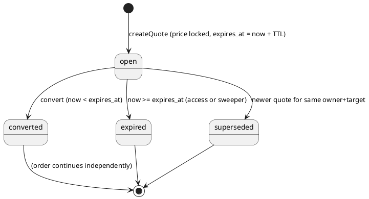
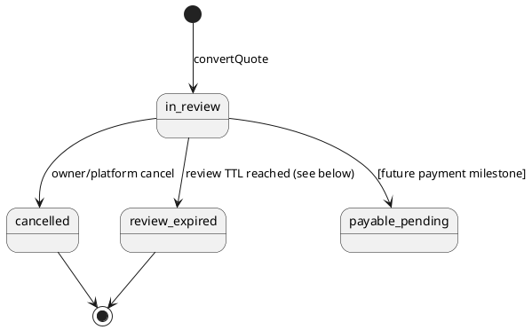

# SPEC-C5-M2 — Commercial Plan Pricing, Price Publication, Quotes and Order-Review Foundations

**Status: SPECIFICATION DELIVERED — IMPLEMENTATION NOT AUTHORIZED.**
Decisions: `docs/adr/0023-c5-m2-decisions.md` (M2-D1…M2-D5, all **A**, approved by
the product owner and transmitted by the Chief Software Architect).
Parent specification: `spec-c5-ext-01-plans-subscriptions-checkout-billing.md`
(this document narrows and supersedes its §6.1/§6.2 pricing-and-quote material
where stated; gateways, settlement, refunds, PDF invoices and renewals remain
later milestones and are NOT part of M2).

**M2 is a non-payment milestone.** No gateway integration, payment attempt,
settlement, refund, receipt/PDF, or renewal processing is specified as
operational here. The order-review UI and API must never imply that an order
has been paid or that a payment transaction has been initiated.

---

## 1. Background

C5-1…C5-4 delivered the versioned plan catalog, subscriptions, entitlement
evaluation and platform administration. C5-EXT-01 M1 added the Free-plan
foundation (`personal-free`, `organization-free`), trusted system activation,
pending recovery, and quota enforcement. Nothing commercial exists yet: no
prices, quotes, orders, promo codes, or tax records. M2 builds the commercial
*foundations* — published prices, price-locked quotes, and order-review drafts —
so that a later payment milestone can attach settlement without reworking
money, ownership, or state machines.

Binding inherited decisions (ADR-0022): integer **Toman** internal money
(AMB-C5-01=B); provider-neutral, operator-configured PSP boundary, no gateway
code (02=A); automatic Organization Free for eligible new organizations (03=B);
exclusive itemized tax (04=A); dompdf only if Persian RTL verification passes
(05=A, later milestone); late verified-payment policy (06=A, later milestone);
platform-controlled audited price administration (07=A); quotes valid 30
minutes by default, administrator-configurable, price preserved while valid
(08=A).

## 2. Requirements (MoSCoW)

### Must
- **M2-R1 Published paid prices.** Prices attach to *published* plan versions;
  at most one published price per (plan version, period) at any instant
  (§6.1 concurrency invariant). Monthly and annual offered only when a valid
  published price exists for that period (M2-D5=A: annual is independently
  published, never derived from monthly, and no discount is inferred from the
  monthly↔annual relationship).
- **M2-R2 Immutable price revisions.** A published price amount never changes
  in place. Correction = supersede with a new revision (old revision retained).
  Free plan keys reject price rows.
- **M2-R3 Integer-Toman money.** Exact integer arithmetic per §5; `*_toman`
  identifiers everywhere; no floats in any financial computation or storage.
- **M2-R4 Quotes.** Server-computed, price-locked quotes: subtotal, discount,
  itemized tax, total; 30-minute default TTL (`billing.quote.ttl_minutes`,
  administrator-configurable); amounts and `price_id` frozen at creation even
  if the price is later superseded; conversion only while `open` and
  `now < expires_at` (conversion at the exact expiry instant fails).
- **M2-R5 Supersession.** Creating a new quote for the same (owner, target
  plan version) supersedes the prior open quote in the same transaction. A
  superseded quote cannot convert — except that idempotent replay of an
  already-successful conversion returns the existing order.
- **M2-R6 Order-review drafts.** Conversion creates an order with its own
  explicit lifecycle, independent of the quote countdown (M2-D3=A as amended).
  Order amounts are immutable snapshots. A created order is never invalidated
  solely because its source quote later expires.
- **M2-R7 Promo evaluation + reservation.** Server-side evaluation only;
  atomic reservation against `max_redemptions` counting open valid
  reservations (M2-D4=A); expired/released/cancelled reservations cease
  consuming capacity; redemption happens only at the later payment milestone
  (an unpaid quote is never marked redeemed).
- **M2-R8 Authorization & isolation.** Personal quotes only for the owner's
  own personal workspace; organization quotes only with the planned
  `organization.billing.manage` permission for that organization (M2-D1=A);
  platform pricing only with the planned `platform.billing.manage` permission
  (M2-D2=A). Cross-owner reads return 404. All amounts are server-calculated.
- **M2-R9 Audit.** Every price publication/supersession, tax-rule change,
  promo change, quote creation/conversion attempt outcome is audited with
  actor, owner, correlation/idempotency key, and before/after identifiers —
  never full promo codes or secrets.
- **M2-R10 MariaDB 10.4 compatibility.** Additive migrations only; `dateTime`
  (never bare `TIMESTAMP`); generated-column/XOR-owner patterns consistent
  with `core_subscriptions`.

### Should
- **M2-R11** Quote read model exposing remaining validity seconds for the
  review countdown (server-derived, never client-trusted).
- **M2-R12** Platform price-history read (all revisions, published pointer).

### Could
- **M2-R13** Promo preview endpoint (evaluate without reserving) — if allowed,
  it must be rate-limited and never reserve capacity.

### Won't (this milestone)
- Payment gateways, payment attempts, callbacks, settlement, refunds,
  receipts, PDF (dompdf or otherwise), renewals, scheduled downgrades,
  proration/upgrade credit, reminder jobs, self-service plan change
  execution. (Quote/order structures must not preclude them.)

## 3. Technical Method

### 3.1 Money and financial arithmetic (normative)

- **Unit:** whole Iranian Toman as PHP `int` / MySQL `BIGINT`, field names
  suffixed `_toman`. No minor units, no `DECIMAL`, no float anywhere in a
  financial path.
- **Bounds:** amounts are `>= 0` at the column level (CHECK) and additionally
  capped by a service-level maximum `billing.max_amount_toman` (default
  9_000_000_000_000_000, comfortably below `PHP_INT_MAX` and BIGINT max);
  inputs above the cap are rejected with 422 before arithmetic. Every
  multiplication is overflow-checked (`int` overflow in PHP raises float
  contamination — services must validate operand ranges so products stay
  within signed 64-bit; percent math uses the decomposition in §3.2).
- **Basis points:** rates are integers 0–10000 (100.00%). Percentage of an
  amount uses round-half-up exactly once per line:
  `pct(amount, bp) = intdiv(amount * bp + 5000, 10000)` with the operand-range
  check `amount <= intdiv(PHP_INT_MAX - 5000, max(bp,1))` enforced before
  multiplication; amounts above that bound are rejected rather than computed
  approximately.
- **Order of computation (exclusive, itemized tax — AMB-C5-04=A):**
  1. `subtotal = price.amount_toman` (single plan line in M2).
  2. `discount` per §3.3, capped at `subtotal` (total never negative).
  3. `taxable = subtotal - discount`.
  4. `tax = pct(taxable, tax_rule.rate_basis_points)` — one tax line per
     applicable active rule (M2 ships with at most one active rule enforced
     transactionally; the line structure allows several later).
  5. `total = taxable + tax`.
  All five values are snapshotted on the quote and copied verbatim to the
  order. Rounding happens only in step 4 (and in percent-discount evaluation,
  §3.3), at line level; there is no order-level re-rounding.
- **Immutability:** quote totals and order totals never change after creation.
  Price or tax-rule edits affect only future quotes.
- **Provider conversion:** converting Toman to a PSP denomination (e.g. Rial)
  is a later, separately reviewed adapter boundary (AMB-C5-02=A). No
  conversion factor exists in M2 code or schema and none may be silently
  introduced.

#### Worked example
Price 1,500,000 تومان; promo −10% (1000 bp); tax 9% (900 bp):
discount = pct(1_500_000, 1000) = 150,000; taxable = 1,350,000;
tax = pct(1_350_000, 900) = 121,500; **total = 1,471,500 تومان**.
Half-up edge: pct(1_005, 1000) = intdiv(1_005_000 + 5_000, 10_000) = 101.

### 3.2 Published-price concurrency invariant (normative)

A naive unique index on `(plan_version_id, period, amount_toman)` does **not**
guarantee one published price (§7 of the authorizing directive). The invariant
is enforced by three cooperating mechanisms:

1. **Canonical pointer.** `core_plan_versions` gains
   `published_monthly_price_id` and `published_annual_price_id` (nullable FK →
   `core_plan_prices`, added by the M2 migration). The published price for a
   period is *by definition* the pointed row; `is_published` remains as a
   history/status flag kept consistent in the same transaction.
2. **Serialized publication transaction.** Publishing revision N+1:
   `BEGIN; SELECT ... FROM core_plan_versions WHERE id=? FOR UPDATE;` (stable
   plan-version row lock) → mark prior pointed revision superseded
   (`is_published=0`, `superseded_at`) → insert/point the new revision
   (`is_published=1`) → update the pointer → audit → `COMMIT`. Two concurrent
   publications serialize on the plan-version row; the later one supersedes
   the earlier, and exactly one pointer value exists at every commit boundary.
3. **Defensive uniqueness.** Unique index `(plan_version_id, period,
   amount_toman)` prevents duplicate identical revisions; a partial guard is
   not relied upon (MariaDB has no partial indexes). Selectable-price
   resolution reads the pointer, never "the row with is_published=1 ORDER
   BY".

Superseded revisions are retained for audit and for quotes that locked them:
a quote keeps its `price_id` and amounts even after supersession (price
preserved while the quote is valid, AMB-C5-08=A).

### 3.3 Promo evaluation and reservation

- Lookup by normalized code (trim + uppercase); the raw code is a lookup key,
  never logged in full in audit details.
- Validity: active, within `starts_at/ends_at`, owner not beyond
  `per_owner_limit` (counting redeemed + open valid reservations for that
  owner), capacity available: `redeemed_count + open_valid_reservations <
  max_redemptions` (when `max_redemptions` is set).
- Discount: percent → `pct(subtotal, value_bp)`; fixed → `min(value_toman,
  subtotal)`. Non-stackable codes exclude other codes; at most one promo per
  quote in M2 (stacking is a later decision — see §9). Total discount capped
  at subtotal.
- **Reservation:** created in the quote-creation transaction after locking
  the promo row (`FOR UPDATE`), state `reserved`, bound to the quote.
  Idempotent quote retries (same idempotency key) return the existing quote
  and its existing reservation — no second reservation.
- **Release:** quote expiry, supersession, or cancellation releases the
  reservation (`released`/`expired`) in the same transaction that changes
  the quote state; released capacity is immediately reusable. A scheduled
  sweeper (console command, dry-run first) expires stale quotes/reservations.
- **Redemption:** only the future payment milestone increments
  `redeemed_count` and marks reservations `redeemed`, inside its payment
  transaction. M2 never does.

### 3.4 Quote and order lifecycles

- **Quote expiry boundary:** conversion requires `now < expires_at`; at
  `now == expires_at` conversion fails with 409 `quote_expired` and the
  reservation is released.
- **Idempotency:** `POST /billing/quotes` and conversion accept an
  idempotency key; replay returns the originally created quote/order with no
  duplicate rows, reservations, or audit spam (single audit entry per actual
  state change). Converting an already-converted quote returns its order.
  Converting a superseded quote (never converted) fails 409 `quote_superseded`.
- **Order-review lifetime (M2-D3=A as amended):** the order has an explicit
  lifecycle independent of the quote. `review_expires_at` is proposed as
  **`billing.order_review_ttl_days`, default 7 days, administrator-configurable
  — PROPOSED DEFAULT, requires product-owner confirmation (see §9)**; no
  unapproved fixed TTL is treated as decided. Expiry of the review window
  moves the order to `review_expired`; it never mutates amounts and never
  resurrects the quote. Cancellation is explicit (`cancelled`), audited, and
  releases nothing monetary (no payment exists). Promotion to payable states
  belongs to the payment milestone and is only named here as a future
  transition, not implemented.
- **Non-payment clarity:** order states in M2 contain no `paid` state and the
  API/UI copy must say the order is registered for review only; no payment
  has been initiated.

### 3.5 Ownership, authorization, isolation

- Owner model mirrors `core_subscriptions`: exactly one of
  `organization_id` / `personal_workspace_id`, generated `owner_key`, unique
  idempotency keys per table.
- Personal quotes: the authenticated user must own the personal workspace
  (owner-only by construction). Organization quotes: the actor must hold
  `organization.billing.manage` **for that organization** (M2-D1=A; granted
  to the eligible owner by default; delegable only through approved scoped
  role/permission administration; never inferred from an unrelated role).
- Platform price/tax/promo administration: `platform.billing.manage`
  (M2-D2=A) — never `platform.subscriptions.manage` by implication.
  These permissions are **specified here only**; adding them to runtime
  catalogs is part of the future M2 implementation authorization.
- Cross-owner quote/order access → 404 (existence not leaked). All monetary
  values are server-calculated; client-supplied totals are ignored/rejected.
- Audience separation: personal plans quote only against personal owners and
  organization plans only against organizations (same check as
  `SubscriptionService::publishedVersion` audience enforcement).

### 3.6 Schema (additive; MariaDB 10.4-safe)

All timestamps `dateTime`; FKs RESTRICT unless stated; money `BIGINT`.

**`core_plan_prices`**: `id` BIGINT UNSIGNED PK; `plan_version_id` FK →
`core_plan_versions` RESTRICT; `period` VARCHAR(10); `amount_toman` BIGINT;
`is_published` TINYINT(1) DEFAULT 0; `published_at`, `superseded_at` dateTime
NULL; `created_by_user_id` FK → users nullOnDelete; timestamps.
Indexes: UNIQUE `(plan_version_id, period, amount_toman)`; KEY `(plan_version_id, period, is_published)`.
**`core_plan_versions` (alter, additive):** `published_monthly_price_id`,
`published_annual_price_id` BIGINT UNSIGNED NULL FK → `core_plan_prices`
nullOnDelete.
**`billing_tax_rules`**: `id`; `key` VARCHAR(60) UNIQUE; `name` VARCHAR(150);
`rate_basis_points` INT; `is_active` TINYINT(1) DEFAULT 1; `valid_from`,
`valid_to` dateTime NULL; `created_by_user_id`; timestamps.
**`billing_quotes`**: `id`; owner pair + `owner_key` VARCHAR(80) (generated,
same pattern as subscriptions); `plan_version_id` FK RESTRICT; `price_id` FK
RESTRICT; `period` VARCHAR(10); `subtotal_toman`, `discount_toman`,
`tax_toman`, `total_toman` BIGINT; `promo_code_id` NULL FK; `status`
VARCHAR(20) (`open|converted|expired|superseded`); `expires_at` dateTime;
`idempotency_key` VARCHAR(80) UNIQUE; `created_by_user_id`; timestamps.
Indexes: KEY `(owner_key, status)`; KEY `(status, expires_at)`.
**`billing_orders`**: `id`; `quote_id` FK UNIQUE; owner pair + `owner_key`;
`status` VARCHAR(20) (`in_review|cancelled|review_expired` in M2);
snapshot totals BIGINT ×4; `review_expires_at` dateTime NULL;
`idempotency_key` VARCHAR(80) UNIQUE; timestamps. KEY `(owner_key, status)`.
**`billing_order_lines`**: `id`; `order_id` FK RESTRICT; `kind`
(`plan|discount|tax`); `description` VARCHAR(300); `amount_toman` BIGINT
(signed; discount negative); `price_id` NULL FK; `tax_rule_key` VARCHAR(60)
NULL; `tax_rate_basis_points` INT NULL; `created_at`. Insert-only.
**`billing_promo_codes`**: `id`; `code_normalized` VARCHAR(60) UNIQUE; `kind`
(`percent|fixed`); `value` INT (bp or whole Toman); `max_redemptions` INT
NULL; `redeemed_count` INT DEFAULT 0; `per_owner_limit` INT DEFAULT 1;
`starts_at`, `ends_at` dateTime NULL; `is_active` TINYINT(1) DEFAULT 1;
`created_by_user_id`; timestamps.
**`billing_promo_reservations`**: `id`; `quote_id` FK CASCADE; `promo_code_id`
FK RESTRICT; `state` (`reserved|released|expired|redeemed`); `idempotency_key`
VARCHAR(80) UNIQUE; timestamps. UNIQUE `(quote_id, promo_code_id)`; KEY
`(promo_code_id, state)`.

Retention: quotes/orders/lines retained as financial-foundation records;
expired quotes prunable after 180 days by an audited console command
(dry-run first) in a later operations milestone.

### 3.7 Services and transactional algorithms

- `PlanPricingService` (platform): `createRevision`, `publishRevision`
  (§3.2 transaction), `unpublish` (= supersede without replacement, pointer
  cleared), `history`. Validates: plan version published; plan key not a
  configured Free key; period valid; amount within bounds.
- `QuoteService::create(actor, owner, planVersionId, period, ?promoCode,
  idempotencyKey)`: authorize owner access → idempotency replay check →
  transaction: lock owner row (subscription-owner lock order consistent with
  C5) → resolve published price via pointer (missing → 422
  `price_unavailable`) → compute (§3.1) with promo row lock + reservation →
  supersede prior open quote (+release its reservation) → insert quote →
  audit → commit.
- `QuoteService::convert(actor, quoteId, idempotencyKey)`: authorize →
  transaction: lock quote row → if converted, return its order → if
  superseded, 409 → if `now >= expires_at`, mark expired + release
  reservation + 409 `quote_expired` → create order + lines (snapshot copy),
  mark quote converted, audit → commit.
- `PromoCodeService` (platform CRUD + `evaluate` used by QuoteService).
- `QuoteExpirySweeper` console command (`billing:expire-quotes {--dry-run}`):
  chunked, transactional per quote, releases reservations, audited counts.
- Error contract: flat `{message, code}`; 401/403 fail-closed; 404 cross-owner;
  409 `quote_expired|quote_superseded|promo_exhausted`; 422 validation and
  `price_unavailable`.

### 3.8 API contracts (future; NOT operational in M2 documentation)

| Endpoint | Actor | Notes |
|---|---|---|
| `GET /api/v1/billing/catalog` | authenticated | Published paid plans + published period prices (int Toman); Free plans shown unpriced; audience-filtered by requested owner context |
| `POST /api/v1/billing/quotes` | owner / org billing manager | Idempotency-Key required; server totals; 201 quote incl. `expires_at`, `remaining_seconds` |
| `GET /api/v1/billing/quotes/{id}` | owner-scoped | 404 cross-owner |
| `POST /api/v1/billing/quotes/{id}/convert` | owner / org billing manager | Creates order-review draft; replay returns existing order |
| `GET /api/v1/billing/orders/{id}` | owner-scoped | Itemized lines, state, `review_expires_at`; explicit `payment_initiated: false` |
| `POST /api/v1/platform/plans/{key}/versions/{v}/prices` | `platform.billing.manage` | Create revision (draft) |
| `POST /api/v1/platform/prices/{id}/publish` | `platform.billing.manage` | §3.2 transaction |
| `POST /api/v1/platform/prices/{id}/unpublish` | `platform.billing.manage` | Clears pointer; open quotes unaffected |
| `POST /api/v1/platform/tax-rules`, `POST /api/v1/platform/promo-codes` | `platform.billing.manage` | Audited configuration |

## 4. Implementation stages (for the future authorization)

1. **S1 Money + pricing core:** `MoneyToman`, schema, `PlanPricingService`,
   pointer invariant, platform price APIs, concurrency suite.
2. **S2 Quotes:** tax rules, promo evaluation/reservation, `QuoteService`,
   sweeper, quote APIs.
3. **S3 Order review:** conversion, order/lines, order read API.
4. **S4 Frontend:** catalog/comparison + quote/order-review pages (Frontend
   Agent; §7 handoff), UX/UI review, visual QA.
5. **S5 Hardening:** MySQL/MariaDB concurrency suites, MariaDB 10.4 gate,
   security review of new endpoints, acceptance.

## 5. Milestones

M2 completes when S1–S5 pass acceptance. It explicitly precedes and does not
include: payment gateway/payment attempts (next milestone), invoices/PDF and
refunds, renewals/reminders/scheduled changes. Each later milestone requires
its own authorization.

## 6. Gathering Results — acceptance criteria

- Two concurrent publications of different amounts for one version+period
  leave exactly one published revision (pointer), both revisions retained.
- Worked-example totals (§3.1) reproduced exactly by property/unit tests,
  including half-up edges and discount-cap cases; no float anywhere
  (static gate on financial code paths).
- Quote created at T converts at T+29:59 and fails at T+30:00 exactly;
  superseded quote cannot convert; conversion replay returns the same order;
  order amounts unchanged after price supersession and after quote expiry.
- Concurrent quotes racing a `max_redemptions=1` promo yield exactly one
  reservation; expiry releases capacity for a subsequent quote.
- Cross-owner quote/order reads 404; org quote without
  `organization.billing.manage` 403; platform pricing without
  `platform.billing.manage` 403; Free plan price creation rejected.
- All five CI gates green incl. MySQL/MariaDB concurrency and MariaDB 10.4
  legacy-timestamp gates. Frontend: catalog/review states verified at
  1440/834/390 with server totals only.

## 7. Frontend / UX-UI handoff (future)

Ocean catalog + comparison (monthly/annual toggle only where both periods
are published; Toman formatting; Free as «رایگان» with no purchase action),
owner-context selection before organizational quoting (billing permission
checked server-side; context chip always visible), quote review page with
itemized lines, live countdown from server `expires_at`, expired state with
re-quote action, promo apply/remove reflecting server evaluation only, and an
order-review confirmation that explicitly states no payment was initiated.
ADR-0020 Amendment B applies (PageSurface flat; standalone cards only per
inventory). Persian RTL; states at 1440/834/390. Frontend must never compute
or alter totals.

## 8. Decision traceability

| Decision | Choice | Where realized |
|---|---|---|
| AMB-C5-01=B | Integer Toman | §3.1, `*_toman` schema |
| AMB-C5-02=A | Provider-neutral PSP, later | §3.1 conversion boundary (named, unimplemented) |
| AMB-C5-03=B | Auto Organization Free | Inherited from M1; catalog marks Free unpriced |
| AMB-C5-04=A | Exclusive itemized tax | §3.1 order of computation, tax lines |
| AMB-C5-05=A | dompdf conditional | Later milestone (PDF); no M2 impact |
| AMB-C5-06=A | Late verified payment | Later payment milestone; no M2 impact |
| AMB-C5-07=A | Platform price administration | §3.5, platform APIs (future) |
| AMB-C5-08=A | 30-min quotes, price preserved | §3.4, §3.2 (locked price_id) |
| M2-D1=A | `organization.billing.manage` | §3.5 (specified, not yet in runtime catalogs) |
| M2-D2=A | `platform.billing.manage` | §3.5, §3.8 (specified only) |
| M2-D3=A (amended) | Independent order lifecycle | §3.4 order state machine, `review_expires_at` |
| M2-D4=A | Open reservations count | §3.3 capacity formula |
| M2-D5=A | Independent annual prices | §2 M2-R1, §3.2 per-period pointers |

## 9. Remaining genuine ambiguities (not silently decided)

1. **Order-review TTL default:** §3.4 proposes `billing.order_review_ttl_days`
   = 7 days configurable — requires explicit product-owner confirmation.
2. **Promo stacking:** M2 specifies one promo per quote; whether stackable
   codes are ever supported needs a future decision.
3. **Tax rule multiplicity:** M2 enforces at most one active rule; multi-rate
   (e.g. regional) taxation is undecided.
4. **Quote for plan change/upgrade credit:** M2 quotes cover initial purchase
   of a plan version; upgrade credit/proration from an existing paid
   subscription is deferred and undecided.
5. **Catalog visibility of unpublished-period plans:** whether a plan with
   only a monthly price appears in annual comparison views as unavailable or
   is hidden — UX decision for S4.
